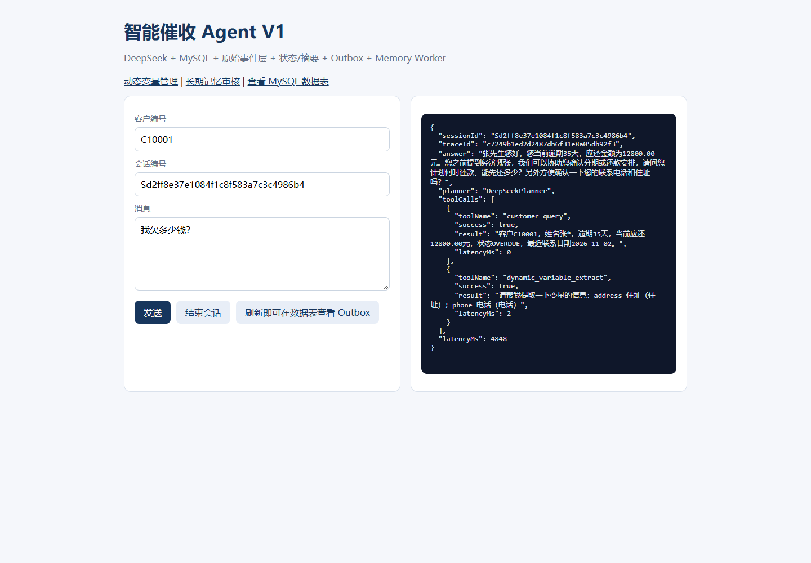
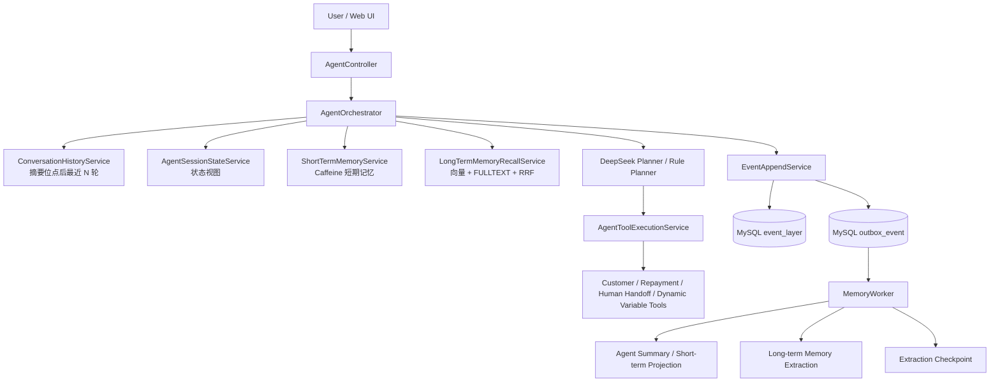

# Collect Agent V1

[](https://github.com/22moya/collect-agent-v1/actions/workflows/ci.yml)
[](https://openjdk.org/projects/jdk/17/)
[](https://spring.io/projects/spring-boot)

基于 Java 17 + Spring Boot + DeepSeek 的智能催收客服 Agent 场景原型。

项目使用模拟客户和模拟还款方案，不包含任何真实公司代码、客户数据或生产凭据。

当前版本使用：

- Java 17
- Spring Boot 4.1.2
- MySQL 9.0+
- Caffeine 本地缓存
- DeepSeek Chat Completions / 原生 Function Calling

当前不依赖 Redis。短期缓存和会话序号都保留了可替换接口，后续接入 Redis 时不需要修改 Agent 主流程。

## 界面预览

### 聊天与工具调用



### 动态变量管理


### 长期记忆人工审核


## 1. 当前能力

- `ReAct` 工具循环
- DeepSeek 原生 `tool_calls`
- 标准 `assistant.tool_calls` + `role=tool` 消息回放
- 欠款查询、还款方案查询、转人工
- 会话动态变量定义、提取和 session 级存储
- 原始事件只追加
- `agent_session_state` 会话结构化状态
- `agent_summary` 会话摘要
- Caffeine 短期记忆缓存
- Outbox + Scheduled Relay + 本地 Memory Worker
- MySQL 9.0 长期记忆：每 10 轮抽取、pending 人工审核、向量 + 全文 RRF 召回

## 2. MySQL 与启动

### 2.1 配置 MySQL

默认连接配置：

```text
Host: 127.0.0.1
Port: 3306
Database: collect_agent
User: collect_agent
Password: 通过 MYSQL_PASSWORD 注入
```

推荐复制 `.env.local.example` 为 `.env.local`，填写本机凭据；该文件已被 `.gitignore` 忽略，应用启动会读取。

```properties
MYSQL_USERNAME=collect_agent
MYSQL_PASSWORD=你的 MySQL 密码
MYSQL_DATABASE=collect_agent
```

也可以直接设置环境变量：

```powershell
$env:MYSQL_USERNAME="collect_agent"
$env:MYSQL_PASSWORD="你的 MySQL 密码"
```

也可以覆盖完整连接：

```powershell
$env:MYSQL_URL="jdbc:mysql://127.0.0.1:3306/collect_agent?useUnicode=true&characterEncoding=UTF-8&useSSL=false&serverTimezone=Asia/Shanghai&allowPublicKeyRetrieval=true"
```

### 2.2 使用 Docker 启动 MySQL

项目需要 MySQL 9.0+，因为长期记忆表使用 `VECTOR(1024)` 和 FULLTEXT ngram。

```powershell
Copy-Item .env.local.example .env.local
# 填写 .env.local 中的 MySQL 密码
docker compose up -d mysql
```

首次启动会执行 `db/mysql/V1__schema.sql` 和 `db/mysql/V2__long_term_memory.sql`。
如果使用已有 MySQL，请手动按顺序执行这两个脚本。

### 2.3 配置 DeepSeek

推荐通过环境变量配置：

```powershell
$env:DEEPSEEK_API_KEY="你的 DeepSeek API Key"
$env:AGENT_LLM_ENABLED="true"
```

不使用模型时可以切换到规则 Planner：

```powershell
$env:AGENT_LLM_ENABLED="false"
```

### 2.4 启动

```powershell
.\mvnw.cmd spring-boot:run
```

默认地址：

| 入口 | 地址 |
| --- | --- |
| 聊天页面 | `http://localhost:8080/` |
| 动态变量管理 | `http://localhost:8080/variables.html` |
| 长期记忆审核 | `http://localhost:8080/long-term-memory.html` |
| MySQL 数据查看 | `http://localhost:8080/debug.html` |
| 聊天接口 | `POST http://localhost:8080/api/agent/chat` |

### 2.5 聊天请求示例

```json
{
  "customerId": "C10001",
  "sessionId": "S-DEMO-001",
  "message": "我现在在成都，我欠多少钱？"
}
```

PowerShell：

```powershell
$body = @{
  customerId = "C10001"
  sessionId = "S-DEMO-001"
  message = "我现在在成都，我欠多少钱？"
} | ConvertTo-Json

Invoke-RestMethod `
  -Method Post `
  -Uri "http://localhost:8080/api/agent/chat" `
  -ContentType "application/json" `
  -Body $body
```

## 3. 总体链路

```text
POST /api/agent/chat
  -> AgentOrchestrator
     -> ConversationHistoryService 回放摘要位点后的最近 N 轮
     -> EventAppendService 追加 USER_MESSAGE
     -> AgentSessionStateService 投影状态
     -> ShortTermMemoryService 刷新 Caffeine
     -> DeepSeek Planner / Rule Planner
        -> 原生 Function Calling
        -> AgentToolExecutionService
        -> TOOL_CALL / TOOL_RESULT 事件
        -> 状态与短期缓存刷新
     -> FinalAnswerEnvelopeService
        -> 解析 reply + state_patch + 可选 variableMap
     -> AgentSessionStateService 合并状态补丁
     -> 追加 ASSISTANT_MESSAGE
     -> 返回聊天响应

同一事务内：
event_layer + outbox_event

异步：
outbox_event
  -> Scheduled Relay
  -> MemoryWorker
     -> 状态幂等投影
     -> 短期缓存刷新
     -> LTM 规则抽取
     -> 轮次结束摘要检查
```

### 核心架构



### 设计取舍

| 问题 | 方案 |
| --- | --- |
| 长会话 Token 持续增长 | 摘要覆盖位点 + 最近 N 轮原文 |
| 工具调用无法回放 | 标准 `assistant.tool_calls` + `role=tool` |
| 事件写入与下游处理耦合 | 事件表与 Outbox 同事务写入，异步 Worker 投影 |
| 重复事件处理 | `session_seq` 幂等判断与状态锁 |
| 长期记忆重复 | 内容哈希 + 结构化事实键 + 语义阈值 |
| 单 Agent 新增变量功能破坏缓存 | 变量定义由 Tool 结果回填，保持 System Prompt 稳定 |

## 4. 同步与异步职责

### 同步主链路

同步链路决定用户本轮是否能及时得到响应，主要完成：

1. 追加用户消息和工具事件；
2. 更新 `agent_session_state`；
3. 刷新短期缓存；
4. 执行工具；
5. 调用 Planner；
6. 校验并合并 `state_patch`；
7. 追加助手消息并返回响应。

### 异步记忆链路

Outbox Relay 和 Memory Worker 负责可重试的派生工作：

1. 按 `session_seq` 幂等重放状态投影；
2. 刷新短期缓存；
3. 执行既有 LTM 规则抽取；
4. 在 `ASSISTANT_MESSAGE` 或 `SESSION_CLOSED` 时检查摘要阈值；
5. 生成新 `agent_summary`。

Redis 以后只应作为缓存投影，不能成为事实源。当前 Caffeine 缓存丢失时，会从 MySQL 重建。

## 5. 会话内序号 seq

```text
event_id：指认哪一条事件
session_seq：表示会话内的处理顺序
```

规则：

- `session_seq` 在单个 `session_id` 内单调递增；
- 当前没有 Redis，使用 `LocalSessionSequenceGenerator`；
- 首次获取序号时查询 MySQL `MAX(session_seq)` 兜底；
- 后续接入 Redis 时，用 `INCR` 实现 `SessionSequenceGenerator`；
- 状态幂等判断使用 `last_seq >= event.session_seq`；
- 摘要回放使用 `session_seq > covers_seq_to`；
- `event_layer` 唯一约束：`(session_id, session_seq)`。

当前单机实现的边界：

- 单 JVM 内并发安全；
- 如果以后多实例部署，必须切换到 Redis `INCR` 或数据库序列表，不能继续只依赖本地计数器。

## 6. 数据库设计

MySQL 9.0 的建表脚本位于 `db/mysql/V1__schema.sql`。本地首次启动可用 `ddl-auto=update`，正式环境建议改为 `validate`，并通过 Flyway/Liquibase 管理版本。

### 6.1 event_layer：原始事实层

只追加、不修改。`event_id` 用于指认事件，`session_seq` 用于会话内顺序。

| 字段 | 含义 |
| --- | --- |
| `id` | 数据库主键 |
| `event_id` | 对外事件唯一标识 |
| `trace_id` | 请求链路标识 |
| `session_id` | 会话标识 |
| `customer_id` | 客户标识 |
| `session_seq` | 会话内单调递增序号 |
| `event_type` | SESSION_STARTED / USER_MESSAGE / TOOL_CALL / TOOL_RESULT / ASSISTANT_MESSAGE / SESSION_CLOSED |
| `payload_json` | 事件载荷 JSON |
| `occurred_at` | 业务发生时间 |
| `created_at` | 入库时间 |

### 6.2 agent_session_state：会话状态表

按 `session_id` 组织。MySQL 使用 `LONGTEXT` 保存 JSON；后续 PostgreSQL 可改为 `JSONB`。

| 字段 | 含义 |
| --- | --- |
| `session_id` | 会话主键 |
| `tenant_id` | 租户标识 |
| `user_id` | 用户/债务人标识 |
| `task` | 任务类型，当前固定 `repayment_reminder` |
| `stage` | opening / reminding / negotiating / confirming / closed |
| `state_json` | `{ "slots": {}, "pending": [], "flags": {} }` |
| `version` | 乐观锁版本 |
| `last_seq` | 已处理到的会话内最后序号 |
| `schema_version` | JSON 结构版本 |
| `expire_at` | 会话过期时间 |
| `created_at` | 创建时间 |
| `updated_at` | 更新时间 |

`state_json` 示例：

```json
{
  "slots": {
    "debt_amount": {
      "value": 12800,
      "confidence": 1.0,
      "source_type": "TOOL_RESULT",
      "source_ref": "e3d8...",
      "updated_at": "2026-11-01T10:00:00"
    },
    "promise_date": {
      "value": "2026-11-10",
      "confidence": 0.98,
      "source_type": "LLM_EXTRACTION",
      "source_ref": "123",
      "updated_at": "2026-11-01T10:01:00"
    }
  },
  "pending": [],
  "flags": {
    "human_handoff_requested": false
  }
}
```

后端维护字段：

- `debt_amount`、`overdue_days`：只读，仅由工具结果写入；
- `pending`：后端根据阶段和缺失槽位计算；
- `flags`：后端维护，LLM 只读；
- `source_type`、`source_ref`、`updated_at`：后端补充。

### 6.3 agent_summary：会话摘要表

| 字段 | 含义 |
| --- | --- |
| `id` | 主键 |
| `tenant_id` | 租户标识 |
| `session_id` | 会话标识 |
| `summary` | 结构化摘要 |
| `covers_seq_from` | 覆盖起始 seq |
| `covers_seq_to` | 覆盖结束 seq |
| `model` | 生成模型 |
| `prompt_version` | 提示词版本 |
| `token_count` | 摘要估算 Token |
| `status` | active / superseded / invalid |
| `created_at` | 创建时间 |

唯一约束：

```text
(tenant_id, session_id, covers_seq_to)
```

最新有效摘要查询顺序：

```text
covers_seq_to DESC,
created_at DESC,
id DESC
```

摘要是否落后：

```text
latest_summary.covers_seq_to < agent_session_state.last_seq
-> 摘要落后

latest_summary.covers_seq_to >= agent_session_state.last_seq
-> 摘要已追上
```

摘要不写入 `agent_session_state`，不参与状态表乐观锁。

### 6.4 其它表

| 表 | 作用 |
| --- | --- |
| `outbox_event` | 事件到本地 Memory Worker 的可靠投递 |
| `agent_long_term_memory` | 唯一长期记忆来源，含 VECTOR(1024)、JSON、FULLTEXT |
| `agent_memory_pending` | 0.5~0.7 低置信度候选，等待人工审核 |
| `agent_memory_extraction_checkpoint` | 每会话长期记忆抽取位点 |
| `dynamic_variable_definition` | 动态变量定义 |
| `dynamic_variable_value` | session 级动态变量值 |
| `dynamic_variable_tool_config` | 动态变量工具开关配置 |

旧版本的 `stm_layer`、`stm_state`、`stm_summary_version`、`ltm_layer`、`agent_memory_vector` 已从源码和 MySQL 中移除。

## 7. 状态视图与状态补丁

LLM 不接收完整数据库实体，只接收状态视图：

```json
{
  "stage": "NEGOTIATING",
  "known_slots": {
    "debt_amount": 12800,
    "overdue_days": 35,
    "repayment_intent": "willing"
  },
  "missing_slots": ["promise_date", "promise_amount"],
  "flags": {
    "human_handoff_requested": false
  },
  "allowed_patch_fields": [
    "promise_date",
    "promise_amount",
    "repayment_intent",
    "refuse_reason",
    "hardship_reason",
    "contact_preference"
  ],
  "allowed_stage_transitions": ["CONFIRMING"]
}
```

最终回答格式：

```json
{
  "reply": "您当前应还 12800 元，已逾期 35 天。请问您计划什么时候还款？",
  "state_patch": {
    "stage": "NEGOTIATING",
    "slots": {
      "repayment_intent": {
        "value": "willing",
        "confidence": 0.95
      }
    }
  },
  "variableMap": {
    "address": "成都市"
  }
}
```

其中：

- `reply` 是最终展示给客户的文本；
- `state_patch` 只允许变化部分；
- `variableMap` 仅在动态变量工具启用并执行后出现；
- 后端会校验日期、金额、枚举、白名单和阶段迁移；
- 非法槽位会被丢弃并记录日志，不会覆盖状态表。

## 8. 短期记忆缓存

当前实现：

```text
ShortTermMemoryCache
  -> CaffeineShortTermMemoryCache
```

缓存键：

```text
shortmem:{tenantId}:{sessionId}
```

缓存内容：

```json
{
  "recentEvents": [],
  "stateJson": "{}",
  "stateViewJson": "{}",
  "latestSummary": "{}",
  "latestSummaryCoversSeqTo": 12,
  "builtAt": "2026-11-01T10:00:00"
}
```

特点：

- Caffeine 采用 `expireAfterAccess`，模拟滑动 TTL；
- 默认 TTL 为 30 分钟；
- 只缓存最近 N 条 USER / ASSISTANT / TOOL_RESULT 事件；
- 缓存未命中时从 `event_layer + agent_session_state + agent_summary` 重建；
- 状态、工具结果、助手消息变化后主动刷新；
- 缓存不是事实源，重启和丢失都可恢复。

未来 Redis 实现只需实现 `ShortTermMemoryCache`，业务代码不变。建议 Redis key：

```text
shortmem:{tenantId}:{sessionId}:events
shortmem:{tenantId}:{sessionId}:state
shortmem:{tenantId}:{sessionId}:summary
```

拆 key 可以避免异步摘要覆盖主链路刚更新的状态。

## 9. 摘要触发策略

摘要只在以下条件触发：

1. 轮次结束：`ASSISTANT_MESSAGE` 或 `SESSION_CLOSED`；
2. 未摘要事件达到 `agent.stm.summary-trigger-event-count`；
3. 未摘要事件估算 Token 达到 `agent.stm.summary-trigger-token-estimate`；
4. 主 Planner 调用前上下文超过 `agent.stm.context-budget-token-estimate`。

摘要处理时保留最近若干条原文，不会把整段对话都压缩掉。

配置：

```yaml
agent:
  stm:
    recent-event-limit: 20
    history-turn-limit: 6
    cache-ttl-minutes: 30
    summary-trigger-event-count: 12
    summary-keep-recent-event-count: 6
    summary-trigger-token-estimate: 4000
    context-budget-token-estimate: 6000
    context-chars-per-token: 2
    summary-prompt-version: v1
```

### 9.1 模型上下文裁剪

每次 Planner 调用不再回放整个 session，而是发送：

```text
固定 system
+ 摘要覆盖位点之后的最近 N 轮标准消息
+ 当前用户消息提示
  - 最新摘要
  - 状态视图
  - 长期记忆 TopK
  - 当前用户消息
  - 已执行工具
```

`agent_summary.covers_seq_to` 是原文回放的下界，`history-turn-limit` 是原文回放的轮次上限。
摘要已经覆盖的内容只通过摘要注入，不再重复发送原消息。工具调用与工具结果按完整轮次保留，避免出现孤立 `role=tool` 消息。

## 10. 目录分层

```text
conversation
  api                 HTTP 接口和 DTO
agentruntime
  application         Agent 主编排、工具执行、消息回放、最终信封解析
  domain              ReAct 动作、观察结果、Planner 上下文
  planner             DeepSeek Planner / Rule Planner
memory
  application         状态、短期记忆、摘要、长期记忆抽取/写入/召回服务
  domain              状态补丁、阶段、状态策略、短期事件、摘要结果
  infrastructure
    cache             Caffeine 短期缓存和可替换接口
    persistence       JPA 实体和 Repository
    summarizer        规则 / DeepSeek 摘要生成器
tooling
  application         工具注册和动态变量服务
  domain              工具接口和结果
  infrastructure
    persistence       动态变量 JPA
    tools              customer_query / repayment_plan_query / transfer_to_human
eventing
  application         事件追加、Outbox Relay、Memory Worker、序号接口
  infrastructure
    persistence       事件和 Outbox JPA
    sequence          本地会话序号生成器
model
  application         LLM 消息和结果模型
  infrastructure      DeepSeek 请求、响应和日志
observability          LLM 交互日志
debug                  MySQL 数据查看接口
db/mysql               MySQL 9.0 V1基础表与V2长期记忆脚本
scripts                MySQL 9.0 安装脚本
shared                配置、异常、TraceId、通用基类
```

## 11. 动态变量

动态变量仍然是 session 作用域，不提升到 LTM。

当前链路：

```text
用户消息
  -> DeepSeek 按需调用 dynamic_variable_extract
  -> 工具返回当前启用的变量名和描述
  -> 最终 JSON 可携带 variableMap
  -> FinalAnswerEnvelopeService 持久化 variableMap
  -> reply 正常返回给用户
```

注意：

- 变量提取不改变主 Agent 身份；
- `dynamic_variable_extract` 工具描述为空，模型只能通过调用结果获得变量定义；
- 提取结果写入 `dynamic_variable_value`；
- 变量值查询地址：`GET /api/dynamic-variables/values?sessionId=...`；
- 变量定义管理页面：`http://localhost:8080/variables.html`。

## 12. 长期记忆

长期记忆唯一事实表是 `agent_long_term_memory`，旧的 `ltm_layer` 和 `agent_memory_vector` 已删除。

抽取规则：

```text
每 10 个完整 ASSISTANT_MESSAGE 轮次抽取一次
Session closed 时执行最终抽取
低置信度 0.5~0.7 写入 agent_memory_pending
置信度 >= 0.7 进入 active 写入流程
```

FACT 结构化字段当前支持：

```text
employment_status：失业、待业、收入来源变化
family_status：家庭关系或家庭成员变化
health_status：疾病、身体状况
financial_status：经济困难、还款压力、资金紧张
```

同一 `fact_key + fact_value` 即使自然语言表述不同，也会合并到一条活跃记忆；
同一 `fact_key` 出现新 `fact_value` 时，旧记录标记为 `superseded`，新值成为 active。
抽取过程和写入分流会输出明确日志，包括轮次不足、Embedding 未启用、候选进入 pending、
精确合并、结构化事实合并、语义合并和最终新增。

向量配置：

```text
模型：text-embedding-v4
维度：VECTOR(1024)
写入：TO_VECTOR(...)
读取：FROM_VECTOR(...)
距离：Java 侧余弦相似度
```

写入链：

```text
LLM候选
-> 类型/敏感信息/structured schema校验
-> content归一化与MD5
-> 哈希精确去重
-> FACT按fact_key + fact_value业务去重
-> 同值合并来源事件，异值将旧值标记superseded
-> 向量Top3 + FULLTEXT Top3
-> 交集判断
-> 更新/细化/取代/新增
-> 成功后才推进 checkpoint
```

召回链：

```text
当前消息 + repayment_intent/refuse_reason/hardship_reason
-> 查询Embedding
-> 稠密Top20 + FULLTEXT Top20
-> RRF融合
-> 归一化RRF + confidence + recency + typeBoost
-> Top5注入动态上下文
-> 异步更新 access_count
```

人工审核接口：

```text
GET  /api/long-term-memory/pending?status=pending
POST /api/long-term-memory/pending/{id}/approve
POST /api/long-term-memory/pending/{id}/reject
```

第一版不会自动提升 pending；审核通过后会生成 embedding、执行去重并转为 active。

### 12.1 动态变量缓存 A/B 测试

本地调试接口：

```http
POST /api/debug/variable-cache-benchmark
```

请求示例：

```json
{
  "variant": "A",
  "iterations": 6,
  "runId": "A-local-001",
  "intervalMs": 600
}
```

变体说明：

```text
A：变量定义通过 dynamic_variable_extract 的 tool result 回填
B：变量定义直接拼入 system prompt
```

运行脚本：

```powershell
pwsh -File scripts/run-variable-cache-ab.ps1 `
  -BaseUrl http://127.0.0.1:18080 `
  -Iterations 6 `
  -Stages 3
```

脚本会在每个阶段修改一次动态变量描述，分别执行 A/B，并在结束时恢复原变量定义。
结果输出到 `cache-benchmark-results/`，包含 JSON 和 CSV 原始采样。

本地受控测试结果：

```text
固定变量场景：
A：稳定命中 384 cached tokens，命中率 68.69%
B：稳定命中 384 cached tokens，命中率 65.75%
两者稳定缓存能力基本一致，差异来自 Prompt 总 Token 数。

会话中途变量变化：
A：首次请求仍命中 384 cached tokens，下降 0 个百分点，恢复 0 ms
B：首次请求命中 0 cached tokens，下降 65.75 个百分点，约 1912 ms 后恢复
```

A 版本通过 tool result 回填变量定义，变量变化不会破坏前置稳定 system 前缀；B 版本把变量放入 system prompt，变量变化会使后续稳定规则同时失去缓存。该结果来自受控的同前缀重复请求，不等同于线上流量收益。

额外进行的 11 次变量变化首次响应测试显示：A 平均 524.8 ms，B 平均 521.3 ms，
端到端耗时差异约 3.5 ms，未观察到稳定的响应时间收益；但缓存命中率分别为 68% 和 0%。
因此当前项目应把 `cachedTokens` 和 `cacheHitRate` 作为主要缓存收益指标，端到端时延需结合 TTFT 继续验证。

用户消息固定为 `你好` 的单独测试结果：

```text
变量固定：A 平均 677 ms，B 平均 801 ms
变量变化：A 平均 767 ms，B 平均 740 ms
```

该结果未显示稳定的端到端响应耗时优势，说明缓存命中收益主要体现在 `cachedTokens` 和缓存恢复窗口；总响应耗时仍受模型生成和网络波动影响。
## 13. 测试

测试使用独立 MySQL 数据库 `collect_agent_test`，数据库由 `application-test.yml` 和 `.env.local` 配置。

运行全部测试：

```powershell
.\mvnw.cmd test -q
```

构建：

```powershell
.\mvnw.cmd package -q -DskipTests
```

覆盖点：

- 用户消息、工具调用、工具结果、助手消息事件完整落库；
- 摘要覆盖位点之后仅回放最近 N 轮原文；
- `session_seq` 从 1 开始连续递增；
- `agent_session_state.last_seq` 跟随最新事件；
- 工具结果写入只读债务槽位；
- LLM 状态补丁白名单校验；
- 非法槽位不会覆盖状态；
- 短期记忆缓存可以从数据库重建；
- 最新 active 摘要按覆盖序号正确读取；
- Outbox Relay 能完成状态、LTM 和摘要异步链路。

## 14. MySQL 运维建议

当前项目已经使用 MySQL 9.0。

本地开发：

- `MYSQL_PASSWORD` 只通过环境变量注入；
- `JPA_DDL_AUTO` 默认是 `update`；
- 首次建库依次执行 `db/mysql/V1__schema.sql`、`db/mysql/V2__long_term_memory.sql`；

正式环境建议：

1. 增加 Flyway 或 Liquibase；
2. 将 `JPA_DDL_AUTO` 改为 `validate`；
3. 数据库账号使用最小权限，不使用 root；
4. 定期备份 `event_layer`、`agent_session_state`、`agent_summary`；
5. 为事件量增长预留按时间或会话归档策略；
6. `state_json` 继续使用 `LONGTEXT`，MySQL 9.0 原生 JSON 类型可作为后续优化项。

### Redis 后续规划

当前没有 Redis 依赖，也没有 Redis 连接配置。

替换时新增：

1. `SessionSequenceGenerator` 的 Redis `INCR` 实现；
2. `ShortTermMemoryCache` 的 Redis 实现；
3. 热缓存失败时自动回退 MySQL；
4. Redis 只作为缓存和序号加速层，事实数据仍以 MySQL 为准。

## 14. 本阶段边界

本阶段没有新增以下能力：

- 多 Agent 协作；
- LTM 自动提升；
- 向量数据库检索；
- 知识库 RAG；
- 跨实例分布式会话锁；
- Prompt / 摘要自动评测。

这些能力应在当前状态、短期记忆和摘要链路稳定后再逐步接入。


## 15. 会话关闭

### 显式关闭

```http
POST /api/agent/sessions/{sessionId}/close
```

请求体：

```json
{
  "reason": "USER_CLOSED"
}
```

返回：

```json
{
  "sessionId": "S-DEMO-001",
  "status": "CLOSED",
  "eventId": "xxx",
  "sessionSeq": 18,
  "closedAt": "2026-11-02T18:00:00"
}
```

关闭流程：

```text
锁定 agent_session_state
-> 检查是否已关闭
-> 追加 SESSION_CLOSED 事件
-> 分配 session_seq
-> 状态 stage=CLOSED
-> flags.session_closed=true
-> 刷新短期记忆
-> Outbox Relay
-> 最终长期记忆抽取
-> 最终摘要检查
```

重复关闭是幂等的，不会重复追加 `SESSION_CLOSED`。

会话关闭后再次调用聊天接口会返回 HTTP `409 Conflict`：

```text
会话已关闭，请创建新会话后再继续对话：{sessionId}
```

这样可以避免关闭后的消息继续写入旧事件流，导致后续长期记忆抽取的轮次和语义失真。

### 超时自动关闭

默认配置：

```yaml
agent:
  session:
    auto-close-enabled: true
    timeout-minutes: 30
    scan-interval-ms: 60000
```

含义：

```text
每分钟扫描一次
agent_session_state.updated_at 超过 30 分钟
且 stage != CLOSED
-> 自动追加 SESSION_CLOSED
-> reason=SESSION_TIMEOUT
```

测试环境默认关闭自动超时，避免测试会话被定时任务干扰。
