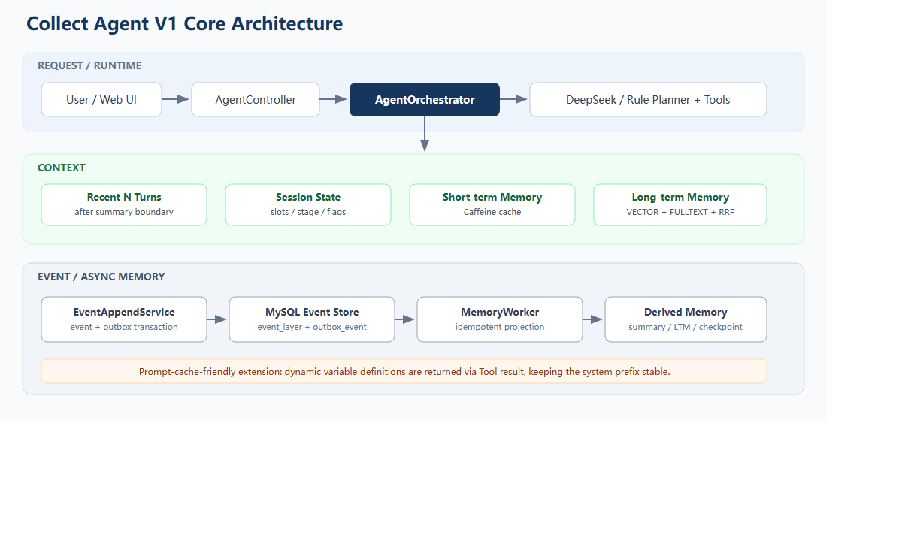
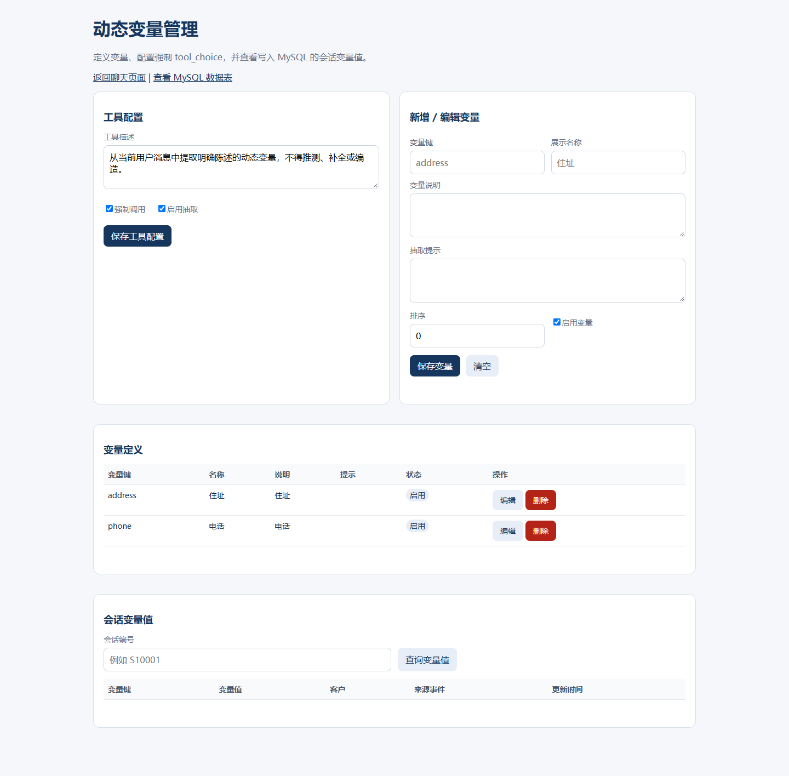
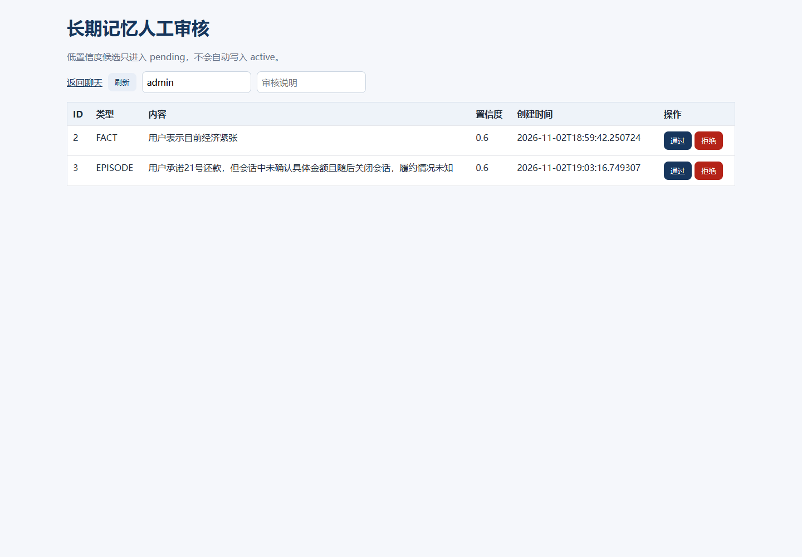

# Collect Agent V1

[](https://github.com/ht-moya/collect-agent-v1/actions/workflows/ci.yml)
[](https://openjdk.org/projects/jdk/17/)
[](https://spring.io/projects/spring-boot)

基于 Java 17、Spring Boot、DeepSeek 和 MySQL 9 的智能催收客服 Agent 场景原型。

项目使用模拟客户与模拟还款方案，不包含真实公司代码、客户数据或生产凭据。


## 项目亮点

- **单 Agent ReAct**：原生 Function Calling、标准 `assistant.tool_calls` / `role=tool` 消息回放、最大步数与转人工兜底。
- **分层上下文**：摘要覆盖位点之后仅回放最近 N 轮原文，并注入状态视图、短期缓存与长期记忆 TopK。
- **长期记忆**：LLM 抽取、人工审核、内容与结构化事实去重、MySQL `VECTOR(1024)` + FULLTEXT 混合召回、RRF 融合。
- **异步事件链路**：事件表与 Outbox 同事务写入，Memory Worker 幂等投影状态、摘要与长期记忆。
- **缓存友好扩展**：通过 Tool 结果动态回填变量定义，在不修改稳定 System Prompt 的前提下为单 Agent 增加变量提取能力。

## 核心架构



架构图源文件：[docs/architecture.svg](docs/architecture.svg)

核心设计取舍：

| 问题 | 方案 |
| --- | --- |
| 长会话 Token 持续增长 | 摘要覆盖位点 + 最近 N 轮原文 |
| 工具调用无法回放 | 标准 `assistant.tool_calls` + `role=tool` |
| 事件写入与下游处理耦合 | 事件与 Outbox 同事务写入，异步 Worker 投影 |
| 重复事件处理 | `session_seq` 幂等判断与状态锁 |
| 长期记忆重复新增 | 内容哈希 + 结构化事实键 + 语义阈值 |
| 新增变量功能破坏缓存 | 固定 System Prompt + Tool 结果动态回填 |

## 缓存友好扩展 A/B 测试

直接修改 System Prompt 可以快速增加变量提取功能，但会使稳定前缀缓存失效。本项目将变量定义放到 Tool 结果中返回，保持前置 System Prompt 稳定。

| 场景 | A：Tool 结果回填 | B：写入 System Prompt |
| --- | ---: | ---: |
| 变量固定，稳定缓存 | 384 cached tokens / 68.69% | 384 cached tokens / 65.75% |
| 变量变化后首次请求 | 384 cached tokens / 68.69% | 0 cached tokens / 0% |
| 缓存恢复窗口 | 0 ms | 约 1912 ms |

完整测试方法、原始数据和耗时结果见：[缓存 A/B 报告](cache-benchmark-results/variable-cache-ab-report.md)。

## 快速启动

前置条件：Java 17、MySQL 9.0+；也可使用 Docker 启动 MySQL。

```powershell
Copy-Item .env.local.example .env.local
# 填写 MySQL 与模型 API Key
docker compose up -d mysql
.\mvnw.cmd spring-boot:run
```

启动后访问：

| 入口 | 地址 |
| --- | --- |
| 聊天页面 | `http://localhost:8080/` |
| 动态变量管理 | `http://localhost:8080/variables.html` |
| 长期记忆审核 | `http://localhost:8080/long-term-memory.html` |
| MySQL 数据查看 | `http://localhost:8080/debug.html` |

不使用模型时可以关闭 LLM，切换到规则 Planner：

```powershell
$env:AGENT_LLM_ENABLED="false"
```

## 主要接口

```text
POST /api/agent/chat
POST /api/agent/sessions/{sessionId}/close
GET  /api/dynamic-variables/definitions
GET  /api/long-term-memory/pending
POST /api/long-term-memory/pending/{id}/approve
POST /api/debug/variable-cache-benchmark
```

## 测试与 CI

```powershell
.\mvnw.cmd test
```

当前包含 13 个单元及集成测试，覆盖聊天事件链、状态补丁、上下文窗口、摘要、长期记忆校验、会话关闭和动态变量接口。

GitHub Actions 使用 MySQL 9 自动执行测试。

## 项目边界

本项目是用于求职展示和技术验证的场景原型，不是生产系统。当前未包含：

- 多 Agent 协作
- 真正面向业务文档的知识库 RAG
- 多租户鉴权与生产级权限体系
- 分布式会话锁、跨实例 Outbox 调度
- 高并发压测与完整生产监控

更详细的界面预览：

<details>
<summary>动态变量管理与长期记忆审核</summary>





</details>
